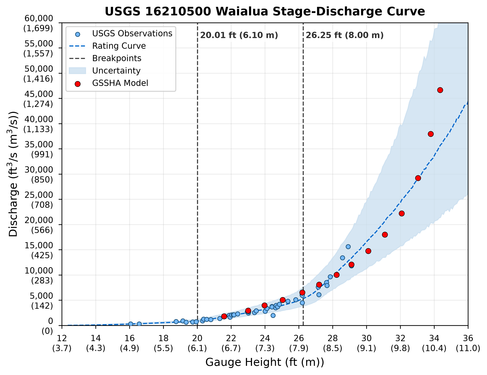

CONTACT: Brian Gorberg  

This project was created to help organize and streamline the flood modeling process. It is used to view USGS stream gauge data, 
calculate probabilities, and determine rating curves. This is then often applied to flood models for calibration, validation, and scenario 
testing.  

In this case, we use three examples of USGS gauges in Hawaii (Waiahole, Waialua, Hanalei). We use 4 scripts to run through a 
modeling analysis. The scripts streamline the process of gathering metadata, pulling observed annual peaks, analyzing the probability, 
calculating rating curves, and then estimating model uncertainty by comparing observations to model outputs. 

**YOU MUST DOWNLOAD PEAK FQ OUTPUTS FOR THIS** ALL USGS GAUGES METADATA FOR HAWAII IS INCLUDED IN THE FOLDER 
PULL_USGS_METADATA** 
https://rconnect.usgs.gov/peakfq/ 

**YOU MUST FOLLOW THE RATING CURVE GITHUB REPOSITORY TO CREATE A KERNEL IN JUPOYTER NOTEBOOKS** 
!!!YOU SHOULD MAKE A NEW ENVIRONMENT!!! 
SEE SOURCE:  
https://github.com/thodson-usgs/ratingcurve 

The scripts do the following: 
1) Select USGS gauges to get metadata and read peakfq results 
2) Derive rating curves for the annual peaks from the peak fq results ^ 
3) Observed rating curves are cleaned into incremental stage values (1ft), the discharge is calculated from the rating curves, 
and then probabilities are estimated using the Peak Fq probability output 
4) An example is provided to compare the modeled and observed rating curves. Uncertainty in the model is calculated using 
the observed rating curves and the GSSHA flood model’s stage/discharge relationship.

Functions are found in the .py files 

SAVE_DATA and figures folders contains all script outputs 

PULL_USGS_METADATA contains Hawaii USGS metadata and a script to retrieve Hawaii gauges, but also a file of retrieved hawaii gauges 

Model_results contain the GSSHA files for script (4) 

SAVE DATA: 
USGS_Gauge_Metadata = script (1) 
Peak_Fq_USGS_probability = script (1) 
Stream_Gauge_Annual_Peaks-input = script ( 1) 
OBSERVED-rating-curves-results = script (2)  
OBSERVED-stage-discharge-probability-results = script (3) 
GSSHA-MODEL-observed-stage-uncertainty = script (4) 
GSSHA-MODEL_stage-discharge-probability-results = script (4)

## Results for Waialua USGS gauge 
| Component | Description |
|---|---|
| Study area | Waialua, Oʻahu, Hawaiʻi |
| USGS gauge | 16210500 |
| Observed data | USGS stage–discharge measurements |
| Rating curve | Fitted stage–discharge relationship |
| Hydraulic model | GSSHA |
| Model results | Simulated discharge at specified water levels |
| Uncertainty | Shaded predictive uncertainty interval |
| Breakpoints | 20.01 ft (6.10 m) and 26.25 ft (8.00 m) |
| Discharge units | ft³/s (m³/s) |
| Stage units | ft (m) |

### Stage–Discharge rating curves and USGS Peak Fq Probability Results

| Stage (ft) | Median Discharge (cfs) | Exceedance Probability | Return Period (years) |
|---|---:|---:|---:|
| 22 | 1,930 | 0.5662 | 1.77 |
| 24 | 3,229 | 0.3599 | 2.78 |
| 26 | 4,946 | 0.2102 | 4.76 |
| 28 | 9,786 | 0.0617 | 16.20 |
| 30 | 16,570 | 0.0166 | 60.10 |
| 32 | 24,548 | 0.0049 | 202.68 |
| 34 | 33,798 | 0.0015 | 657.18 |

*Table 1. Selected stage–discharge probability results for Waialua, sourced from the CSV values displayed in the repository.*

**[View Complete Waialua Results (CSV)](SAVE_DATA/OBSERVED-stage-discharge-probability-results/Waialua_stage_discharge_probability.csv)**

### Waialua Stage–Discharge Rating Curve w/ Model Output for Calibration/Validation

The figure below compares observed USGS stage–discharge measurements, the fitted rating curve, and simulated discharge from the GSSHA hydraulic model for Kaukonahua Stream at Waialua, Hawaiʻi (USGS 16210500).

*Figure 1. Comparison of USGS observations, fitted rating curve, uncertainty bounds, and GSSHA model simulations for Waialua.*

